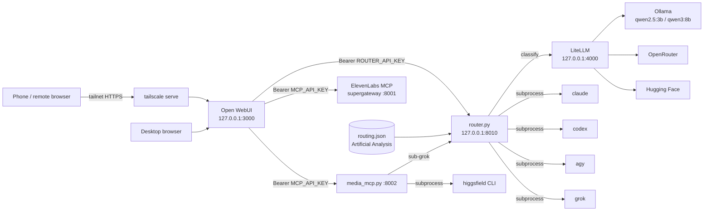

# Architecture

## Components

| File | Role |
|---|---|
| `docker-compose.yml` | Open WebUI and LiteLLM containers, both published on loopback only |
| `litellm_config.yaml` | Model aliases: `local-fast`, `local-daily`, `openrouter-auto`, `openrouter/*`, `hf-inference` |
| `router.py` | FastAPI OpenAI-compatible API (`/v1/models`, `/v1/chat/completions`, `/health`). Classifies, plans and dispatches each request |
| `aa_routing.py` | Builds `routing.json` (task → ranked models) from the public AA models page (Data API as fallback); `choose()` applies the subscription-first rule |
| `routing.json` | Current routing table. Rebuilt on every start |
| `media_mcp.py` | FastMCP server: Grok Q&A plus Higgsfield image/video generation |
| `claude-media-mcp.json` | MCP servers `sub-claude` may use in media mode (hub `:8001`/`:8002` only). The key is filled in from the environment |
| `Dockerfile.agent` | Image for `sub-claude-agent`: Claude Code as a non-root user. `start.ps1` builds it from stdin, so `.env` never enters the build context |
| `workspace/` | The only host folder `sub-claude-agent` can see (gitignored). Uploads land in `workspace/uploads/<request>/` |
| `agy-settings.json` | Lockdown profile for the router's Antigravity CLI (copied into `agy-home/` on every start) |
| `start.ps1` / `stop.ps1` | Lifecycle: secrets, Ollama model pull, Docker, background processes, `tailscale serve` |

## Request flow (`smart-router`)

1. Open WebUI sends `POST /v1/chat/completions` with the router bearer key.
2. `classify()` asks `local-daily` (`qwen3:8b`, `think: false`) for one task label, returned as JSON. If that fails, the task is `chat`.
3. `plan()`:
   - Sends `media` (image/video/speech/job status) to `sub-claude` in media mode (see Security model).
   - Ranks `chat` on the general index.
   - Sends every other task to `aa_routing.choose()`:
     - Rank models by the task's evaluation. Pro-only evals fall back to the Intelligence Index when the data lacks them.
     - The best-ranked subscription model wins, with the CLI model id and effort taken from the AA variant name.
     - Fallback chain: the other subscription CLIs in rank order, then the top API model as `openrouter/<id>`.
4. Uploaded images (base64 data URLs, png/jpeg/gif/webp, max 20 MB each) are written to a fresh `sandbox/req-*` folder, which becomes the CLI's working folder and is deleted after the reply.
   `call_route()` runs the CLI, or forwards the request to LiteLLM. On failure the router moves down the fallback chain and reports the reason in the `X-Router-Note` header.
5. The reply is prefixed with the route and the reason. If the client asked for streaming, it's returned as a single SSE chunk.

### Task → evaluation map

| Task | AA evaluation (first available) |
|---|---|
| coding | `frontiercode_v2_0`, `terminalbench_v4_0` |
| agentic | `terminalbench_v4_0`, `tau_banking`, `automationbench_aa` |
| science_math | `critpt_v2_hard`, `terminalbench_science`, `hle_diamond` |
| knowledge | `aa_omniscience_index` |
| long_document | `gdp_pdf`, `aa_lcr` |
| instructions | `ifbench` |
| finance / legal / medical / engineering / business / economics | matching `artificial_analysis_*_index` |
| general | `artificial_analysis_intelligence_index` |

The public models page carries every key above except `ifbench`, so `instructions` currently ranks on the Intelligence Index. Through the Data API, per-benchmark keys need a **Pro** key; the free tier has only the Intelligence Index and the domain indices.

Subscription models are listed in `SUB_MODELS` in `aa_routing.py`. Add a row when a CLI gains a model.

## Security model

The router can spend your subscriptions and the MCP server can spend Higgsfield credits, so every layer is locked down.

**Network**
- Every service binds to `127.0.0.1`. Docker Desktop's `host.docker.internal` still reaches loopback services on the host.
- Phone access goes only through `tailscale serve`, which is HTTPS and tailnet-only. Nothing is exposed on the LAN.

**Authentication**
- The router needs `ROUTER_API_KEY`. Both MCP servers need `MCP_API_KEY`. LiteLLM needs `LITELLM_MASTER_KEY`.
- `start.ps1` generates all three, and `.env` is ACL'd to the current Windows user.
- `media_mcp.py` also enforces a DNS-rebinding Host allow-list.

**CLI lockdown**
Each CLI runs in its own `sandbox/req-*` folder, which holds only that request's uploaded images, with `KEY|TOKEN|SECRET|PASSWORD` environment variables removed. Every CLI may search and fetch the web. None may run a shell, write files or read outside its folder. Each was verified with a canary file outside the folder.
- **claude:**
  - `--restricted` (confines `Read` to the request folder), `--tools Read WebSearch WebFetch`, `--strict-mcp-config`, and `--permission-mode dontAsk`.
  - `--setting-sources project`, so no user hooks, plugins or allow-rules load.
  - `ENABLE_CLAUDEAI_MCP_SERVERS=false`, so claude.ai connectors (Gmail, Drive, …) don't load.
  - `--` before the prompt, so a prompt starting with `-` can't inject flags.
  - If `CLAUDE_CODE_OAUTH_TOKEN` is set, it's passed to `claude` (and only `claude`) so the long-lived token replaces the expiring sign-in.
  - Media mode only: `--mcp-config claude-media-mcp.json` plus `mcp__media mcp__elevenlabs` in `--allowedTools`. That adds the hub's Higgsfield, Grok and ElevenLabs tools, and still no shell or outside-folder file access.
- **codex:** read-only sandbox; shell, exec, apps and browser disabled; `web_search=live`; images passed with `-i`; ephemeral session. Code mode stays on because web search runs through it (canary probe: it can't read outside the folder).
- **grok:** only `todo_write`, `web_search` and `web_fetch` are allowed, plus an explicit deny list. No `read_file`: the canary probe showed it isn't confined to the working folder, so Grok gets no images.
- **agy:** an isolated profile (`agy-home/`) with `toolPermission: strict`, a deny list (everything but web search), and no trusted workspaces. Strict mode denies `read_file` even with an allow rule, so Gemini gets no images. The sign-in comes from the OS keyring.
- **sub-claude-agent:** full Claude Code tools (`bypassPermissions`), fenced by Docker rather than by the CLI. Claude's own Bash sandbox is off on Windows: in the canary probe, `--restricted` blocked `Read` but a shell `type` still read the file.
  - The container mounts only `workspace/` and runs as a non-root user, with all capabilities dropped, `no-new-privileges`, 512 processes and 4 GB of memory. It is removed after each request and stopped after 30 minutes.
  - `host.docker.internal` resolves to the container itself. It has internet access for web tools.
  - It authenticates with `CLAUDE_CODE_OAUTH_TOKEN` (from `claude setup-token`), passed only to this container. Anything running inside could read that token.
- **higgsfield:** called through `node` rather than the npm `.cmd` shim, so prompts never pass through `cmd.exe` parsing. Model, aspect-ratio and job-id inputs are checked against an allow-list pattern, and duration is limited to 1–30 seconds.

**Known limits**
- Web access means a fetched page can carry prompt-injection text. The CLIs hold nothing worth stealing except the conversation itself; `sub-claude-agent` can also reach `workspace/` and its own token.
- `sub-claude-agent` can still reach the host through Docker Desktop's gateway IP. Every hub service there needs a key, except Ollama.
- Sub CLIs still carry each provider's own user memory and instructions. For example, `claude` loads your global CLAUDE.md.
- Open WebUI keeps its settings in its database after first boot. Changing env vars later doesn't update them; change them in Admin Settings.
